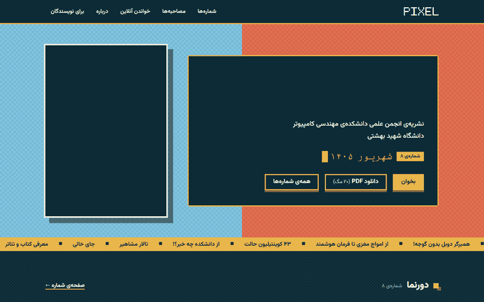
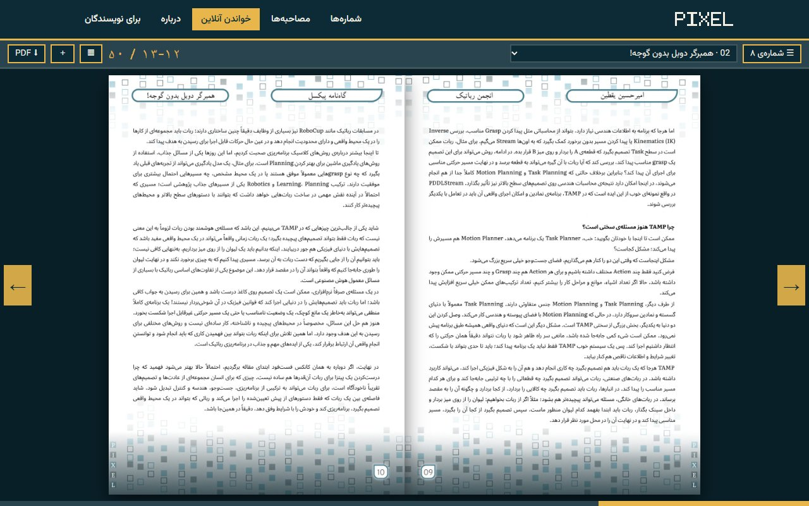
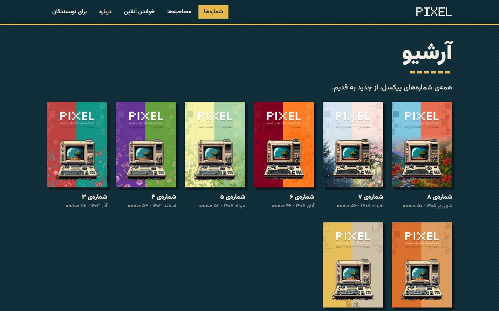
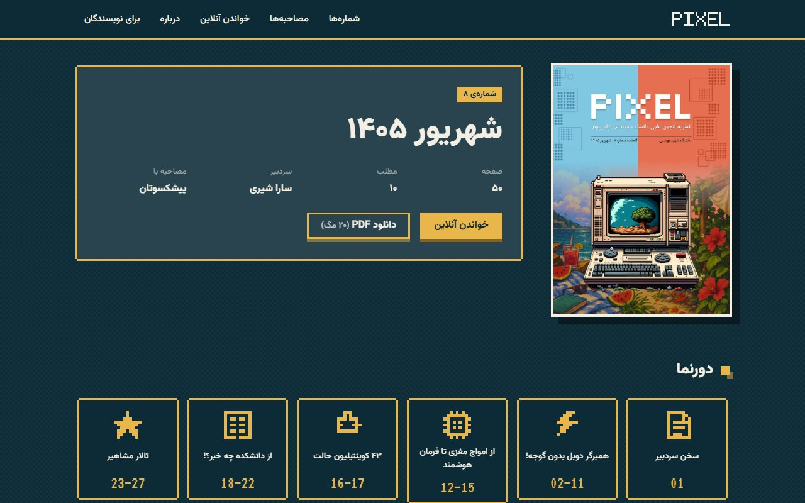
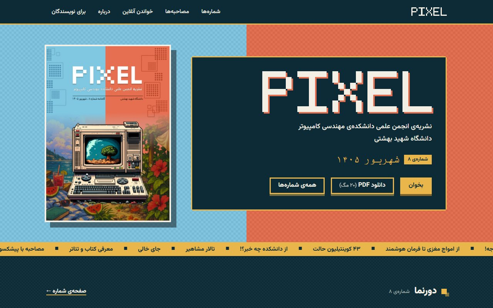
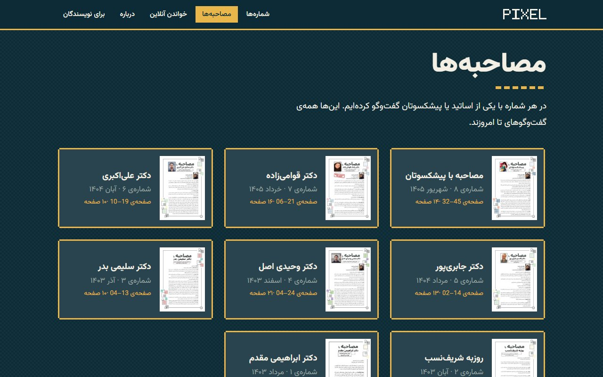

# Pixel — Online Magazine Archive

An online archive for **Pixel**, the publication of the Computer Engineering Scientific Association at Shahid Beheshti University.
Every issue can be paged through online, opened straight at an article from its table of contents, or downloaded as a full PDF.

**🌐 Live site: [amirhosseinamadeh.github.io/magazine-blog](https://amirhosseinamadeh.github.io/magazine-blog/)**

Built with [Astro](https://astro.build) and hosted on GitHub Pages.

<p align="center">
  
</p>

## Screenshots

**Read every issue online**, a page spread at a time, jumping between articles from the table of contents:



| Archive | Issue page |
|---|---|
|  |  |
| **Home** | **Interviews** |
|  |  |

## Features

- A shelf of every issue (8 so far, from Mordad 1403 to Shahrivar 1405)
- An issue page with the cover, editor and table of contents
- A page-by-page online reader and PDF download
- An interviews page collecting the faculty interviews
- A "write for us" page for contributors to upcoming issues
- Full right-to-left layout, mobile friendly

## Project structure

```
scripts/import_issues.py   turns each issue PDF into covers and page images
site/                      the Astro site
  src/content/issues/      one file per issue (number, date, editor, colours, table of contents)
  src/pages/               site pages (home, archive, issue, reader, interviews, about, write)
  public/magazine/         covers and page images (PDFs are in the release)
.github/workflows/         builds and deploys the site to GitHub Pages on every push
docs/screenshots/          images used in this README
```

## Magazine files

Covers and page images are committed under `site/public/magazine/`, so a fresh clone builds the full site.
The PDFs (about 240 MB) are too large for the repository, so they are attached to the
[`issues` release](https://github.com/AmirhosseinAmadeh/magazine-blog/releases/tag/issues) and the download buttons link there.

To add a new issue, put its PDF in the repository root as `Pixel-No<N>*.pdf`, run the import script, then upload the PDF to the release:

```bash
pip install pymupdf
python -X utf8 scripts/import_issues.py
```

For each issue the script writes into `site/public/magazine/<NNN>/`: a copy of the PDF, large and small covers, every page as an image, and thumbnails. Its output (page count and cover colours) is used to fill in `src/content/issues/`; also set `pdfBytes` to the PDF size.

```bash
gh release upload issues Pixel-No<N>*.pdf
```

## Running

```bash
cd site
npm install
npm run dev      # http://localhost:4321/magazine-blog/
npm run build    # static output in site/dist
```

## Copyright

The magazine content (text, images, covers and PDF files) belongs to Pixel and the authors of each article.

## Contact the publication

- 📣 Telegram channel: [t.me/pub_sbu](https://t.me/pub_sbu)
- ✉️ Telegram: [t.me/CSE_Publication](https://t.me/CSE_Publication)
- 🌐 LinkedIn: [linkedin.com/company/sbu-publication](https://www.linkedin.com/company/sbu-publication)
